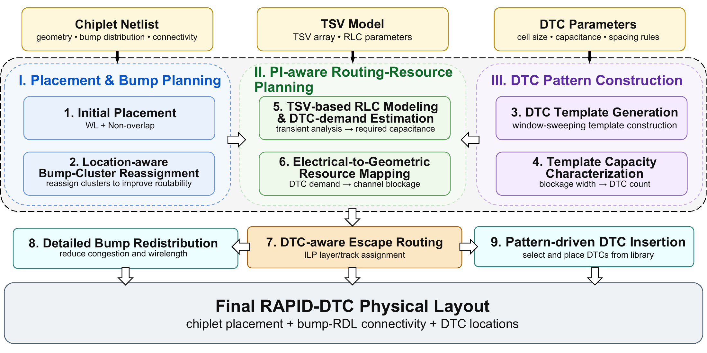
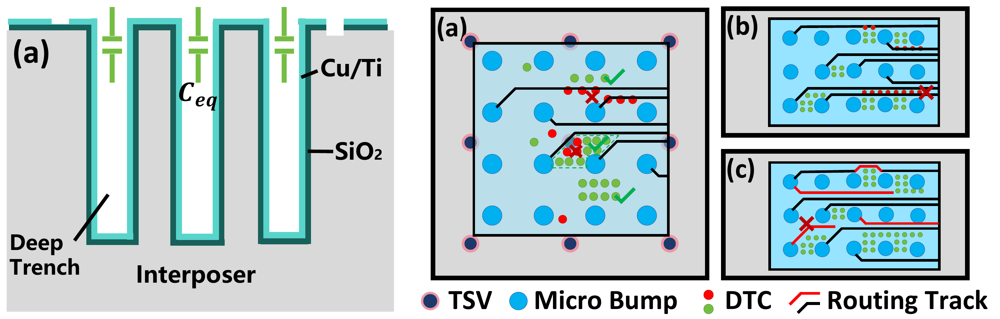

# RAPID-DTC

**A Routability and Power Supply Integrity-aware Framework for Chiplet and Deep Trench Capacitor Array Placement**

RAPID-DTC co-optimizes chiplet placement, bump redistribution, deep trench capacitor (DTC) insertion, and escape routing for 2.5D systems. This repository provides the C++ routing, redistribution, and DTC insertion module; related placement code is available in [ULTRA-2.5D](https://github.com/ElectroWarriors/ULTRA-2.5D).

<p align="center">
  
</p>

*Framework overview (Figure 5 of the paper).*

<p align="center">
  
</p>

*Left: deep trench capacitor structure (Figure 4(a)). Right: resource conflicts among DTCs, TSVs, micro-bumps, and routing tracks (Figure 3).*

## Dependencies and Build

- Linux, CMake 3.13+, and a C++17 compiler.
- IBM ILOG CPLEX and Concert, with a valid license.
- JsonCpp.

Update the compiler paths, `CPLEX_ROOT_DIR`, `JSON_ROOT_DIR`, library names, and C++ ABI setting in [CMakeLists.txt](CMakeLists.txt) to match your installation. Then run from this repository's root:

```bash
cmake -S . -B build
cmake --build build --parallel
```

The executable is generated at `bin/router`. Ensure the CPLEX and JsonCpp shared libraries are available to the dynamic loader.

## Cases and Running

Use the cases and case-preparation workflow from [ULTRA-2.5D](https://github.com/ElectroWarriors/ULTRA-2.5D#building-and-running). The router follows the same workspace-root and relative-case-directory calling convention:

```bash
./bin/router "/absolute/path/to/ULTRA-2.5D/" "celldata/atplace_case/case_8c/" -RD -CB
```

Both path arguments must end with `/`. Here, `case_8c` illustrates the directory convention; prepare the placed chiplets, TSV data, and DTC-demand annotations listed below before running.

- `-RD`: enable detailed bump redistribution and DTC insertion.
- `-CB`: account for DTC blockage in the redistribution flow's routing capacity.

## Inputs and Outputs

All paths below are relative to the selected case directory.

| Input | Contents |
| --- | --- |
| `json_chiplets/chiplet.json` | Placed chiplets, pins, and nets, including pin-level `capDensity` and `typePower`. |
| `json_chiplets/interposer.json` | TSV geometry and DTC demand in the `TSVs` array. |
| `place_init/case_discription.json` | Interposer size, TSV-array dimensions, and chiplet bump-array dimensions. |

The router reads chiplet positions from `json_chiplets/chiplet.json`; transfer placement results there if they are stored separately. `capDensity` denotes DTC count per unit area. Keep geometry units and chiplet ordering consistent across the inputs.

| Output | Contents |
| --- | --- |
| `json_chiplets/output_track.json` | Escape-routing tracks and, with `-RD`, inserted DTC locations. |
| `json_chiplets/chiplets_rdl.json` | Updated chiplet, pin, and net database; generated with `-RD`. |


